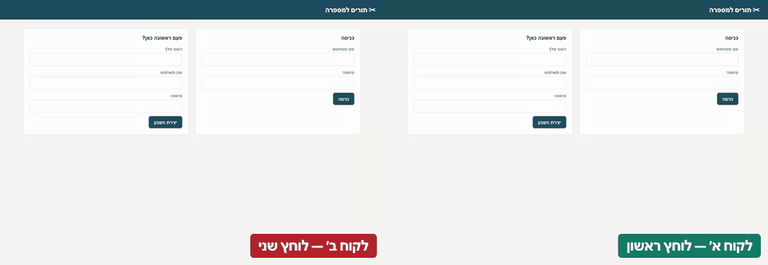

# qa-api-starter

[](https://github.com/DorGodin/qa-api-starter/actions/workflows/ci.yml)

A ready-to-use test framework for any product with an HTTP API, in Python and pytest: API suites, edge cases,
security, a real browser, load, an LLM feature, and the reports, history and bug filing around them. It ships
with a small demo API, so it runs the moment you clone it. Point it at your own product by adding one block of
configuration and one class per API resource - nothing in the framework knows which product it is testing.

[עברית למטה](#בעברית)

---

## What is in it

| Suite | What it checks | Run it |
|---|---|---|
| Product | the API behaves: flows, rules, permissions, paging, the money math | `make test` |
| Contract | every response matches the product's own OpenAPI document | part of `make test` |
| Edge cases | bad input is refused cleanly | `make edge` |
| Security | nobody reaches what is not theirs; nothing leaks in an error | `make security` |
| Browser | what a person sees and does, in a real browser (Playwright) | `make ui` |
| LLM | an AI feature does not invent data (DeepEval, offline metrics) | `make llm` |
| Load | thresholds that fail the pipeline (k6): smoke, load, write path, spike, soak, stress | `make perf` |
| Framework | the framework's own code - no API, no network | `make unit` |

And around every run:

| | |
|---|---|
| `make report` | the last run: counts, failures with their assertion, skips with their reason |
| `make dashboard` | one HTML page: the history of every run, and every object the runs created |
| `make trends` | what got worse against earlier runs of the same shape |
| `make cleanup ENV=...` | what the runs left on an environment; `YES=1` deletes it |
| `pytest --file-bugs` | one ticket per failed test, with the calls that reproduce it (`--file-bugs-dry-run` first) |
| `make env-check ENV=...` | proves an environment is usable before any test runs - read-only |

Every push runs all of it in CI, and `gitleaks` keeps secrets out of the repository.

## Start, with the demo

1. Install:

   ```bash
   make install
   ```

2. Start the demo API, in one terminal:

   ```bash
   make api
   ```

3. Run the tests, in another:

   ```bash
   make test
   ```

4. After a run, `make report` shows the result and `make dashboard` the history of every run.

No Python? `docker compose run --rm tests` runs it all in a container.

## Using it on your own product

1. **Add your environment** to `config/config.json`: its URL, the product's name (`product` - which suite
   folders belong to it), the roles your tests act as (`personas`) and how they log in (`auth`). Every key is
   required; nothing is guessed.
2. **Put the passwords outside git** - environment variables (`QA_OWNER_PASSWORD`, ...) or
   `config/config.local.json`, which git ignores.
3. **Prove the setup** before writing a test. It logs in as every role and creates nothing:

   ```bash
   make env-check ENV=qa
   ```

4. **Write the first suite.** One class per API resource in `obj/<your product>/` (copy
   `obj/resources/items.py`), one happy path and one unhappy path in `tests/<your product>/`, and map the
   folder to the product in `PRODUCT_FOLDERS` (`tests/conftest.py`). Assert values, not only status codes.
   `/new-suite <resource>` in Claude Code writes the skeleton.
5. **Wire CI**: one secret per role, and `ENV` on the job, with `make env-check` as its first step.
6. **Remove the demo** when you no longer want it: `demo_api/`, `obj/resources/`, the demo suites, and
   `fastapi`/`uvicorn` from `requirements.txt` (then `scripts/maintenance/relock.sh`).

Keep `tests/unit/`, the production guard, the reports, the bug filer and CI - none of it is product-specific.
Several products can live side by side: each environment names its product, and only that product's
folders are collected.

## Rules

`CLAUDE.md` is the contract: where payloads live, which suite a test belongs to, what every data-creating
helper must guard. `docs/pitfalls.md` is the log of mistakes and the rules that came out of them. Claude Code
reads both, and `.claude/` holds its agents, skills and commands for this workflow.

---

## Example product: the barbershop

The framework also tests a real product from the outside: [barber-booking-api](https://github.com/DorGodin/barber-booking-api),
a barbershop's booking site. It shares no code with this repository - the suites know it only through its URL
and its documented contract - which is the proof that the framework is not tied to its demo. Everything here
is that product's own, and none of it is needed for yours.



**Where it lives**

| | |
|---|---|
| `obj/barber/` | its API objects, and `booking_page.py`, the page object for its site |
| `tests/barber/` | its API suites: bookings, sign-in by SMS code, permissions, security, standing bookings, ... |
| `tests/barber_ui/` | its site in a real browser: every screen, accessibility (WCAG 2.2 AA), phones, journeys end to end |
| `perf/barber/` | its load scripts: a race for the same time, the evening rush, sign-in by code |
| `mutants/barber-booking.yml` | its mutation catalogue: each rule broken on purpose, and the suite that must notice |
| `utils/fake_sms.py`, `utils/fake_push.py` | fake SMS and push providers its suites read codes and notifications from |
| `ENV=barber` | its test copy on port 8101 - never the copy a person uses |

**Running it**

1. Clone [barber-booking-api](https://github.com/DorGodin/barber-booking-api) next to this folder, and start
   its test copy:

   ```bash
   cd ../barber-booking-api && cp .env.example .env && make install && make run-test
   ```

2. Back here, tidy the test copy if earlier runs filled it, then run its suites:

   ```bash
   make tidy-test-copy           # resets the test copy when it has grown too big
   make test ENV=barber          # the API
   make ui-barber                # the site in a browser
   make ui-barber-mobile         # the same, on an iPhone (WebKit) and an Android phone
   make ui-barber-journeys       # whole journeys, all on the screen
   make perf-barber              # the three load scripts
   make mutate-check             # the mutation catalogue still matches the product - seconds
   make mutate                   # break it rule by rule - about 25 minutes, end of day
   ```

The mutation runner (`scripts/mutate.py`) and `make tidy-test-copy` are written for the barbershop today; the
rest of the framework is shared.

---
---

<a id="בעברית"></a>

# בעברית

תשתית מוכנה לבדיקות של כל מוצר שיש לו API, בפייתון ו־pytest: בדיקות API, מקרי קצה, אבטחה, דפדפן אמיתי, עומס,
פיצ'ר AI, ומסביב להם דוחות, היסטוריה ופתיחת באגים. היא מגיעה עם API קטן לדוגמה, כך שהיא רצה מהרגע שמשכפלים
אותה. כדי לכוון אותה למוצר שלכם מוסיפים בלוק הגדרות אחד ומחלקה אחת לכל משאב של ה־API. שום דבר בתשתית עצמה לא
יודע איזה מוצר היא בודקת.

## מה יש בה

| סוויטה | מה היא בודקת | איך מריצים |
|---|---|---|
| מוצר | ה־API מתנהג נכון: תהליכים, חוקים, הרשאות, דפדוף, החשבון של הכסף | `make test` |
| חוזה | כל תשובה תואמת את מסמך ה־OpenAPI של המוצר עצמו | חלק מ־`make test` |
| מקרי קצה | קלט שגוי נדחה כמו שצריך | `make edge` |
| אבטחה | אף אחד לא מגיע למה שלא שלו, ושום דבר לא דולף בהודעת שגיאה | `make security` |
| דפדפן | מה שאדם רואה ועושה, בדפדפן אמיתי (Playwright) | `make ui` |
| LLM | פיצ'ר AI לא ממציא נתונים (DeepEval, מדדים בלי חיבור לרשת) | `make llm` |
| עומס | ספים שמפילים את הפייפליין (k6): בדיקה מהירה, עומס, כתיבה, קפיצה, ריצה ארוכה, לחץ | `make perf` |
| התשתית | הקוד של התשתית עצמה, בלי API ובלי רשת | `make unit` |

ומסביב לכל ריצה:

| | |
|---|---|
| `make report` | הריצה האחרונה: מספרים, כישלונות עם הבדיקה שנכשלה, דילוגים עם הסיבה |
| `make dashboard` | עמוד HTML אחד: ההיסטוריה של כל הריצות, וכל מה שהריצות יצרו |
| `make trends` | מה השתנה לרעה לעומת ריצות קודמות מאותו סוג |
| `make cleanup ENV=...` | מה שהריצות השאירו בסביבה; עם `YES=1` זה נמחק |
| `pytest --file-bugs` | כרטיס אחד לכל בדיקה שנכשלה, עם הקריאות שמשחזרות אותה (קודם `--file-bugs-dry-run`) |
| `make env-check ENV=...` | מוודא שהסביבה שמישה לפני שבדיקה כלשהי רצה, בלי לשנות כלום |

כל push מריץ את הכל ב־CI, ו־`gitleaks` דואג שסודות לא ייכנסו למאגר.

## איך מתחילים, עם הדוגמה

1. התקנה:

   ```bash
   make install
   ```

2. מפעילים את ה־API לדוגמה, בטרמינל אחד:

   ```bash
   make api
   ```

3. מריצים את הבדיקות, בטרמינל אחר:

   ```bash
   make test
   ```

4. אחרי ריצה, `make report` מציג את התוצאה ו־`make dashboard` את ההיסטוריה של כל הריצות.

אין פייתון? `docker compose run --rm tests` מריץ הכל בקונטיינר.

## שימוש על המוצר שלכם

1. **מוסיפים סביבה** ב־`config/config.json`: הכתובת, שם המוצר (`product`, שקובע אילו תיקיות בדיקות שייכות
   לו), התפקידים שהבדיקות פועלות בשמם (`personas`), ואיך הם מתחברים (`auth`). כל מפתח הוא חובה, ושום דבר
   לא מנוחש.
2. **הסיסמאות מחוץ ל־git**: במשתני סביבה (`QA_OWNER_PASSWORD` וכו') או ב־`config/config.local.json`, ש־git
   מתעלם ממנו.
3. **מוודאים שההגדרה עובדת** לפני שכותבים בדיקה. זה מתחבר בכל תפקיד ולא יוצר כלום:

   ```bash
   make env-check ENV=qa
   ```

4. **כותבים את הסוויטה הראשונה.** מחלקה אחת לכל משאב של ה־API ב־`obj/<המוצר שלכם>/` (מעתיקים את
   `obj/resources/items.py`), מסלול תקין אחד ולא תקין אחד ב־`tests/<המוצר שלכם>/`, ומקשרים את התיקייה למוצר
   ב־`PRODUCT_FOLDERS` (בקובץ `tests/conftest.py`). בודקים ערכים, לא רק קודי סטטוס. הפקודה
   `/new-suite <resource>` ב־Claude Code כותבת את השלד.
5. **מחברים ל־CI**: secret אחד לכל תפקיד, `ENV` על ה־job, ו־`make env-check` כצעד הראשון.
6. **מורידים את הדוגמה** כשהיא כבר לא נחוצה: `demo_api/`, `obj/resources/`, הסוויטות לדוגמה, ו־`fastapi`
   ו־`uvicorn` מ־`requirements.txt` (ואז `scripts/maintenance/relock.sh`).

את `tests/unit/`, ההגנה על פרודקשן, הדוחות, פתיחת הבאגים וה־CI משאירים, כי שום דבר מהם לא תלוי במוצר. כמה
מוצרים יכולים לחיות זה לצד זה: כל סביבה מציינת את המוצר שלה, ורק התיקיות של המוצר הזה נאספות לריצה.

## הכללים

`CLAUDE.md` הוא החוזה: איפה נמצאים ה־payloads, לאיזו סוויטה שייכת בדיקה, ממה כל helper שיוצר נתונים חייב
להגן. `docs/pitfalls.md` הוא היומן של הטעויות ושל הכללים שיצאו מהן. Claude Code קורא את שניהם, ובתיקייה
`.claude/` יש לו סוכנים, מיומנויות ופקודות לעבודה הזו.

---

## מוצר לדוגמה: המספרה

התשתית בודקת מבחוץ גם מוצר אמיתי: [barber-booking-api](https://github.com/DorGodin/barber-booking-api), אתר
לקביעת תורים במספרה. אין לו שום קוד משותף עם המאגר הזה, והבדיקות מכירות אותו רק דרך הכתובת שלו והחוזה המתועד
שלו. זו ההוכחה שהתשתית לא קשורה לדוגמה שלה. כל מה שבחלק הזה שייך למוצר הזה, ושום דבר ממנו לא נחוץ למוצר שלכם.

**איפה הוא נמצא**

| | |
|---|---|
| `obj/barber/` | אובייקטי ה־API שלו, ו־`booking_page.py`, ה־page object של האתר |
| `tests/barber/` | בדיקות ה־API שלו: תורים, כניסה בקוד SMS, הרשאות, אבטחה, תורים קבועים ועוד |
| `tests/barber_ui/` | האתר שלו בדפדפן אמיתי: כל המסכים, נגישות (WCAG 2.2 AA), טלפונים, מסעות מקצה לקצה |
| `perf/barber/` | סקריפטי העומס שלו: מרוץ על אותה שעה, עומס של ערב, כניסה בקוד |
| `mutants/barber-booking.yml` | קטלוג המוטציות: כל כלל נשבר בכוונה, והסוויטה שחייבת לשים לב |
| `utils/fake_sms.py`, `utils/fake_push.py` | ספקי SMS והתראות מדומים, שמהם הבדיקות קוראות קודים והתראות |
| `ENV=barber` | עותק הבדיקות שלו בפורט 8101, אף פעם לא העותק שמשתמשים בו |

**איך מריצים**

1. משכפלים את [barber-booking-api](https://github.com/DorGodin/barber-booking-api) לצד התיקייה הזו, ומפעילים
   את עותק הבדיקות שלו:

   ```bash
   cd ../barber-booking-api && cp .env.example .env && make install && make run-test
   ```

2. חוזרים לכאן, מנקים את עותק הבדיקות אם ריצות קודמות מילאו אותו, ומריצים את הסוויטות שלו:

   ```bash
   make tidy-test-copy           # מאפס את עותק הבדיקות כשהוא גדל מדי
   make test ENV=barber          # ה־API
   make ui-barber                # האתר בדפדפן
   make ui-barber-mobile         # אותו דבר, באייפון (WebKit) ובאנדרואיד
   make ui-barber-journeys       # מסעות שלמים, הכל על המסך
   make perf-barber              # שלושת סקריפטי העומס
   make mutate-check             # קטלוג המוטציות עדיין תואם את המוצר, תוך שניות
   make mutate                   # שבירה כלל אחרי כלל, בערך 25 דקות, בסוף היום
   ```

מריץ המוטציות (`scripts/mutate.py`) והפקודה `make tidy-test-copy` כתובים כרגע עבור המספרה. כל שאר התשתית
משותפת.
